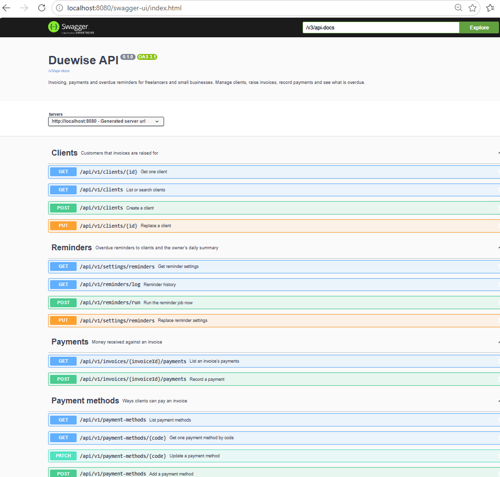
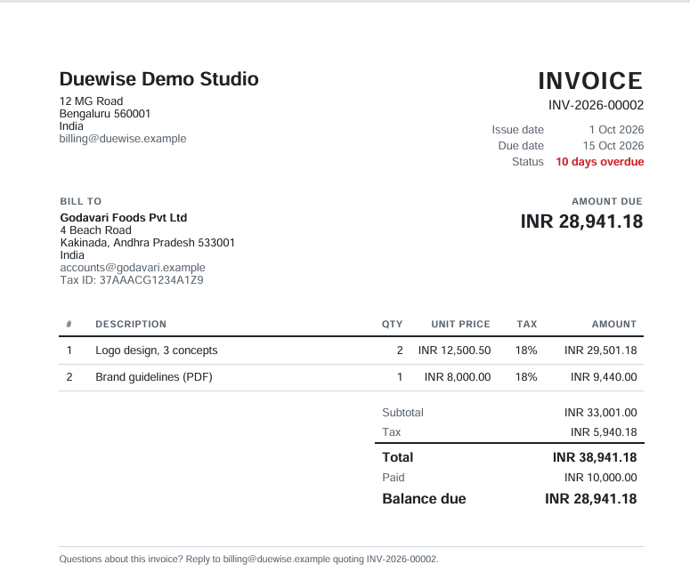
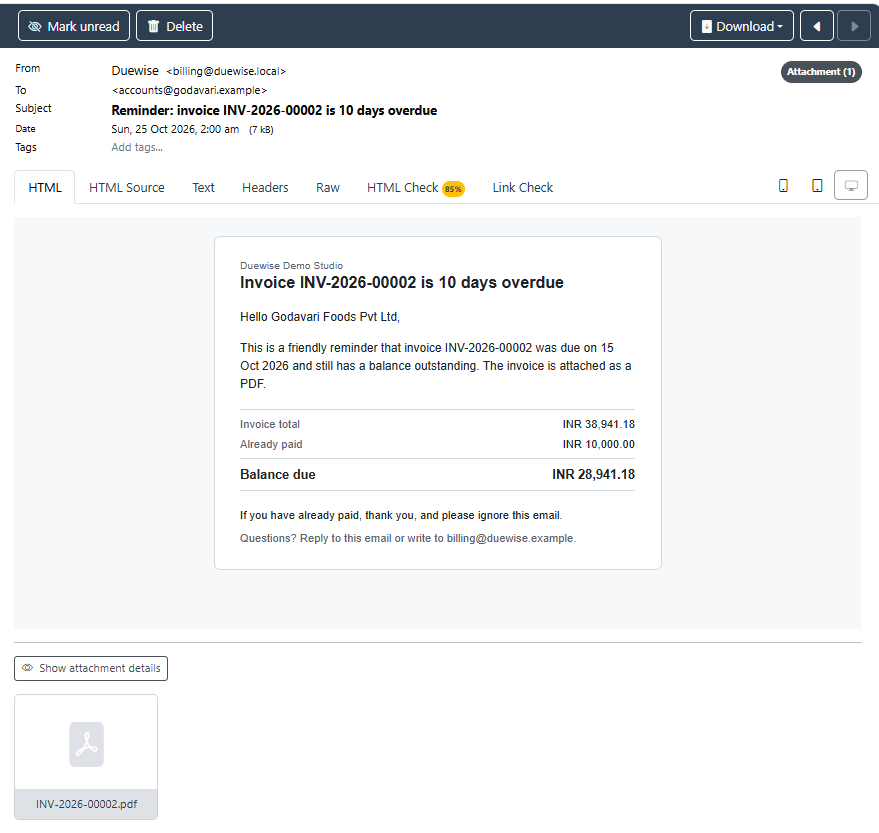

# Duewise — get paid on time

[](https://github.com/developeras95/duewise-invoicing-api/actions/workflows/ci.yml)


    
Invoicing, payments and automatic overdue reminders for freelancers and small businesses, as a REST API.

Small businesses lose money to late payment: invoices go out as Word files, nobody tracks what is overdue,
and chasing clients is awkward and easy to forget. Duewise keeps every invoice, payment and balance in one
place, sends the PDF reminder for you on a schedule you choose, and emails you one summary of who owes what.

## Contents

- [Features](#features)
- [Screenshots](#screenshots)
- [Quick start (Docker only)](#quick-start-docker-only)
- [Releases](#releases)
- [Developer setup](#developer-setup)
- [Configuration](#configuration)
- [API overview](#api-overview)
- [Walkthrough: from client to reminder](#walkthrough-from-client-to-reminder)
- [Errors](#errors)
- [Design decisions](#design-decisions)
- [Testing and quality](#testing-and-quality)
- [Project structure](#project-structure)
- [Tech stack](#tech-stack)
- [License](#license)

## Features

- **Clients** with billing email, address, tax ID, default currency and payment terms; search and paging.
- **Invoices** with line items, per-line tax, multiple currencies and correct rounding. Drafts can be edited
  or deleted; sending issues a **gapless invoice number** (`INV-2026-00001`, `INV-2026-00002`, ...).
- **Payments** in full or in part, by UPI, bank transfer, card, cheque or cash (a transaction reference is
  required for all but cash). The invoice moves from
  `SENT` to `PARTIALLY_PAID` to `PAID` on its own; overpayments are refused.
- **PDF invoices** on A4, with `DRAFT`, `PAID` and `VOID` stamps and Indian digit grouping (`INR 1,25,000.00`).
- **Automatic reminders**: every morning, each overdue invoice gets an email with its PDF attached on the
  days you choose (default 1, 7 and 14 days overdue), and you get one summary of everything overdue.
  Each reminder is sent once; a failed send is retried on the next run.
- **Client statements**: what a client owes per currency, split into current, 1–30, 31–60, 61–90 and
  90+ days overdue.
- **Reference data** as tables, not hard-coded lists: 8 currencies and 5 payment methods to start with,
  each can be added or deactivated through the API.
- **Safe concurrent edits**: two people editing the same invoice cannot overwrite each other silently.
- **Consistent errors** in the standard [RFC 9457](https://www.rfc-editor.org/rfc/rfc9457) problem format.
- **Interactive API documentation** with Swagger UI.

## Screenshots

| Swagger UI | PDF invoice | Reminder email |
| --- | --- | --- |
|  |  |  |

## Quick start (Docker only)

Needs only [Docker Desktop](https://www.docker.com/products/docker-desktop/). Java and Maven run inside the build.

```bash
git clone https://github.com/developeras95/duewise-invoicing-api.git
cd duewise-invoicing-api
docker compose --profile app up -d --build
```

The first build takes a few minutes while Maven downloads dependencies; later starts take seconds.
When `docker compose logs app` shows `Started DuewiseApplication`, open:

| What | URL |
| --- | --- |
| Swagger UI (try every endpoint) | http://localhost:8080/swagger-ui.html |
| Health check | http://localhost:8080/actuator/health |
| Mailpit, the inbox for every email the app sends | http://localhost:8025 |

No email leaves your computer in this setup: [Mailpit](https://mailpit.axllent.org/) catches it all.
Stop with `docker compose --profile app down` (the database is kept; add `-v` to delete it).

## Releases

Each version is published on the [Releases page](https://github.com/developeras95/duewise-invoicing-api/releases)
with its runnable jar and notes, and as a Docker image on GitHub Container Registry:

```bash
docker pull ghcr.io/developeras95/duewise-invoicing-api:1.0.0
```

The image needs a PostgreSQL database and an SMTP server; the Compose setup above provides both. Changes per
version are listed in [CHANGELOG.md](CHANGELOG.md).

## Developer setup

Needs Java 21 and Docker Desktop.

```bash
# 1. Start PostgreSQL and Mailpit
docker compose up -d

# 2. Run the application; Flyway creates the database schema on the first start
./mvnw spring-boot:run          # Windows: mvnw.cmd spring-boot:run
```

In IntelliJ IDEA, open the folder as a Maven project and run `DuewiseApplication`.
The defaults in `application.yml` match the Docker services, so no configuration is needed.

## Configuration

Every setting has a working default for local use. Override any of them with environment variables.

| Variable | Default | Purpose |
| --- | --- | --- |
| `DB_URL` | `jdbc:postgresql://localhost:5432/duewise` | Database connection |
| `DB_USERNAME` / `DB_PASSWORD` | `duewise` / `duewise` | Database login |
| `SERVER_PORT` | `8080` | HTTP port |
| `MAIL_HOST` / `MAIL_PORT` | `localhost` / `1025` (Mailpit) | SMTP server |
| `SPRING_MAIL_USERNAME` / `SPRING_MAIL_PASSWORD` | none | SMTP login, for a real mail server |
| `SPRING_MAIL_PROPERTIES_MAIL_SMTP_AUTH` / `..._STARTTLS_ENABLE` | `false` | Set both to `true` for Gmail and most providers |
| `MAIL_FROM` | `Duewise <billing@duewise.local>` | Sender of every email |
| `MAIL_REPLY_TO` | none | Where client replies go |
| `BUSINESS_NAME` | `Duewise Demo Studio` | Printed on PDFs and emails |
| `BUSINESS_ADDRESS` | `12 MG Road,Bengaluru 560001,India` | One address line per comma |
| `BUSINESS_EMAIL` / `BUSINESS_TAX_ID` | none | Printed on PDFs when set |
| `BUSINESS_TIME_ZONE` | `Asia/Kolkata` | Decides what "today" and "overdue" mean |
| `REMINDERS_CRON` | `0 0 9 * * *` (09:00 daily) | When reminders run, in the business time zone |
| `REMINDERS_SCHEDULER_ENABLED` | `true` | `false` turns the daily run off; the manual endpoint still works |
| `REMINDER_OWNER_EMAILS` | `owner@duewise.local` | First recipients of the daily summary; afterwards managed through the API |

### Sending real email

With Docker, copy [`.env.example`](.env.example) to `.env`, uncomment the mail section and fill it in.
Compose reads `.env` automatically; it is ignored by git, so the password is never committed.
For Gmail use an [app password](https://myaccount.google.com/apppasswords), never your normal password.
When running from an IDE, set the same variables in the run configuration instead.

With real email on, every overdue invoice emails its client's billing address. Test with clients whose
addresses you own.

## API overview

All endpoints are under `/api/v1`. Full request and response schemas, with examples, are in Swagger UI.

| Area | Endpoints |
| --- | --- |
| Clients | `GET /clients` (search, paging) · `GET /clients/{id}` · `POST /clients` · `PUT /clients/{id}` |
| Statements | `GET /clients/{id}/statement` |
| Invoices | `GET /invoices` (filter by status, client, overdue, dates) · `GET /invoices/{id}` · `POST /invoices` · `PUT /invoices/{id}` (drafts) · `DELETE /invoices/{id}` (drafts) |
| Invoice actions | `POST /invoices/{id}/send` · `POST /invoices/{id}/void` · `GET /invoices/{id}/pdf` |
| Payments | `POST /invoices/{id}/payments` · `GET /invoices/{id}/payments` |
| Reminders | `POST /reminders/run` · `GET /reminders/log` · `GET /settings/reminders` · `PUT /settings/reminders` |
| Reference data | `GET`, `POST`, `PATCH` on `/currencies` and `/payment-methods` |

## Walkthrough: from client to reminder

The commands use `curl` (on Windows PowerShell, type `curl.exe`). Every step can also be done in Swagger UI.

**1. Create a client**

```bash
curl -X POST http://localhost:8080/api/v1/clients -H "Content-Type: application/json" -d '{
  "name": "Godavari Foods", "email": "accounts@godavari.example",
  "defaultCurrencyCode": "INR", "paymentTermsDays": 15,
  "address": {"line1": "4 Beach Road", "city": "Kakinada", "countryCode": "IN"}
}'
```

Returns `201 Created` with the client, including its `id` (here `1`).

**2. Create a draft invoice**

```bash
curl -X POST http://localhost:8080/api/v1/invoices -H "Content-Type: application/json" -d '{
  "clientId": 1,
  "lines": [{"description": "Logo design, 3 concepts", "quantity": 2, "unitPrice": 12500.50, "taxRate": 18}]
}'
```

Issue date, due date (today + the client's payment terms) and currency come from the client when left out.
Totals are calculated by the server:

```json
{
  "id": 1, "invoiceNumber": null, "status": "DRAFT", "currencyCode": "INR",
  "subtotal": 25001.00, "taxTotal": 4500.18, "total": 29501.18, "balanceDue": 29501.18,
  "version": 0
}
```

**3. Send it.** The invoice gets its number and can no longer be edited.

```bash
curl -X POST http://localhost:8080/api/v1/invoices/1/send
```

```json
{ "id": 1, "invoiceNumber": "INV-2026-00001", "status": "SENT", "version": 1 }
```

**4. Record a part payment**

```bash
curl -X POST http://localhost:8080/api/v1/invoices/1/payments -H "Content-Type: application/json" -d '{
  "amount": 10000, "paymentMethod": "UPI", "reference": "UPI-4521987730"
}'
```

The invoice is now `PARTIALLY_PAID` with a balance of `19501.18`.

**5. Download the PDF**

```bash
curl -o INV-2026-00001.pdf http://localhost:8080/api/v1/invoices/1/pdf
```

**6. See what the client owes**

```bash
curl http://localhost:8080/api/v1/clients/1/statement
```

**7. Run the reminders now** instead of waiting for 09:00

```bash
curl -X POST http://localhost:8080/api/v1/reminders/run
```

```json
{ "runDate": "2026-10-25", "overdueInvoices": 1, "clientRemindersSent": 1,
  "clientRemindersFailed": 0, "clientRemindersSkipped": 0, "ownerDigest": "SENT" }
```

An invoice is only reminded once it is past its due date, so a freshly created one is skipped. The emails
appear in Mailpit at http://localhost:8025, and every attempt is listed at `GET /api/v1/reminders/log`.

## Errors

Every error uses the [RFC 9457](https://www.rfc-editor.org/rfc/rfc9457) problem format, with a stable `code`
for programs to check and, for invalid input, one entry per field:

```json
{
  "type": "about:blank",
  "title": "Validation failed",
  "status": 400,
  "detail": "One or more fields are invalid.",
  "instance": "/api/v1/clients",
  "code": "VALIDATION_FAILED",
  "errors": [
    { "field": "email", "message": "must be a well-formed email address" }
  ]
}
```

| Status | When |
| --- | --- |
| `400` | Invalid input: missing fields, wrong formats, unknown values |
| `404` | The resource in the URL does not exist |
| `409` | Conflict: a duplicate email or code, a record changed since you read it, or an action the invoice's status does not allow (editing a sent invoice, paying a draft, voiding a paid one) |
| `422` | Valid input that breaks a business rule: overpaying, sending an invoice with no lines or a zero total, referring to a client or payment method that does not exist |

## Design decisions

**Gapless invoice numbers.** Tax authorities expect invoice numbers without gaps. A database sequence leaves
gaps whenever a transaction rolls back, so Duewise keeps one counter row per year and increments it with
`INSERT ... ON CONFLICT DO UPDATE ... RETURNING` inside the same transaction that sends the invoice. If sending
fails, the number is rolled back with it. Drafts have no number, so deleted drafts leave no gaps either.

**Optimistic locking.** Every client and invoice carries a `version`. An update must send the version it read;
if someone else saved in between, the request gets `409 Conflict` instead of silently overwriting their change.

**Money.** Amounts are `BigDecimal` in Java and `NUMERIC(15,3)` in PostgreSQL, never floating point. Each line
is rounded half-up to its currency's minor units (2 for INR and USD, 0 for JPY, 3 for KWD) before totals are
added up, the way printed invoices are checked.

**Reminders that cannot double-send.** Every attempt is recorded in `reminder_log`, with a unique index per
invoice and reminder day and one per day for the summary, and the run skips anything already logged as sent.
Running it again the same day, by hand or after a restart, sends nothing twice. A failed attempt is logged with its error and retried on the next run. An
invoice found late (say 10 days overdue on its first check) gets the latest reminder it has reached (day 7)
rather than every missed one.

**One idea of "today".** "Today" and "overdue" use the business time zone (`Asia/Kolkata` by default) through
an injected `Clock`, never the server's own zone, so results do not depend on where the server runs. Unit
tests use a fixed clock, so they behave the same on any day and on any CI runner.

**The database owns its schema.** Flyway migrations create every table, constraint and index; Hibernate only
validates that the entities match (`ddl-auto: validate`).

## Testing and quality

```bash
./mvnw verify
```

- **131 tests**: fast unit tests for business rules and controllers, and integration tests that run against a
  real PostgreSQL 17 (started by [Testcontainers](https://testcontainers.com/)) and a real SMTP server
  ([GreenMail](https://greenmail-mail-test.github.io/greenmail/)) to check each email and its PDF attachment.
- **Coverage gate**: [JaCoCo](https://www.jacoco.org/) fails the build below 90% line or 70% branch coverage.
  The report is at `target/site/jacoco/index.html`.
- **CI**: GitHub Actions runs the same `verify` on every push and pull request, and publishes the coverage
  summary on each run.

Docker must be running for the integration tests.

## Project structure

```
src/main/java/com/duewise/
├── client/          clients and their addresses
├── invoice/         invoices, line items, totals, numbering, status rules
├── payment/         payments against invoices
├── statement/       per-client balances and ageing
├── pdf/             PDF rendering from a Thymeleaf template
├── reminder/        daily job, reminder emails, settings, log
├── currency/        currency reference data
├── paymentmethod/   payment method reference data
├── common/          error handling, paging, money formatting
└── config/          application settings, clock, caching, OpenAPI
src/main/resources/
├── db/migration/    Flyway SQL migrations (V1–V5)
└── templates/       PDF and email templates
```

## Tech stack

Java 21 · Spring Boot 4.1 · Spring Data JPA (Hibernate 7) · PostgreSQL 17 · Flyway · Thymeleaf ·
OpenHTMLtoPDF · Spring Mail · springdoc-openapi · JUnit 5 · Mockito · Testcontainers · GreenMail · JaCoCo ·
Docker Compose · GitHub Actions

## License

Copyright © 2026 Abhijit Saha. **All rights reserved.** The source code is published for reading and
evaluation; see [LICENSE](LICENSE) for what is allowed without permission. For a commercial licence, contact
me through [GitHub](https://github.com/developeras95).

Third-party libraries keep their own licences: see [THIRD-PARTY-NOTICES.md](THIRD-PARTY-NOTICES.md).
